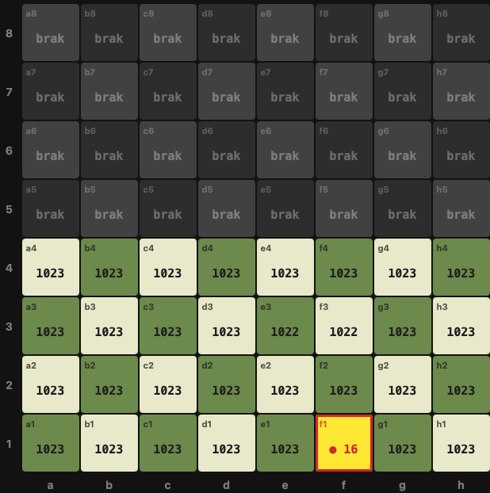
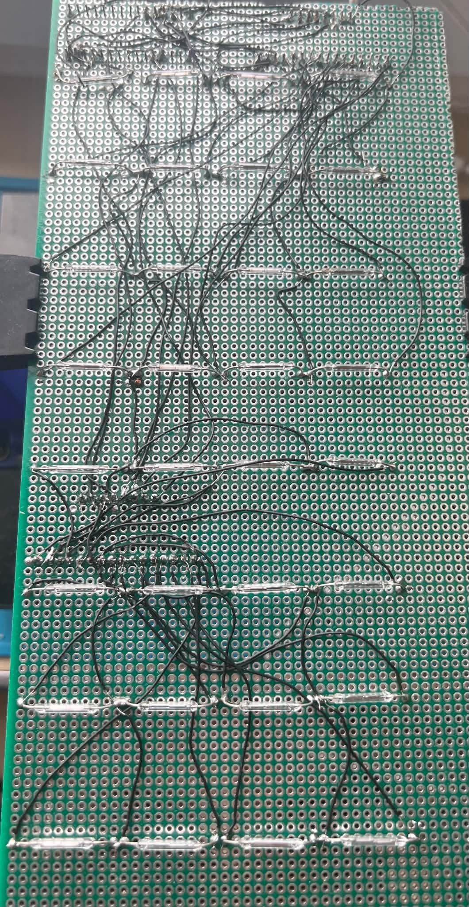
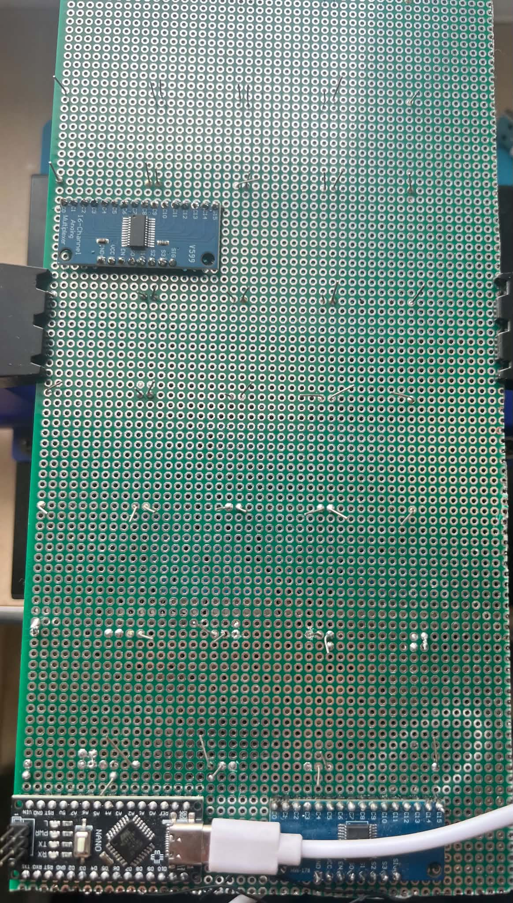

# Magnetic Chess Board — Real-Time Piece Tracking System

An electronic chessboard built around an Arduino Nano and a 64-sensor magnetic matrix that detects piece positions in real time and tracks game moves automatically without player intervention.

## How It Works

Each chess piece has a small neodymium magnet embedded in its base. Beneath each of the 64 squares sits a normally-open (NO) magnetic reed switch. When a piece rests on a square, its magnet closes the reed switch, pulling the corresponding multiplexer channel to `GND`. The Arduino scans the matrix and streams the board state over Serial to a live Python web dashboard.

Piece identity (pawn, knight, rook, etc.) is not read directly from the sensor — instead, the system tracks pieces in software based on the known starting position and standard chess rules, updating the internal board representation as squares are vacated and occupied.

## Hardware Overview

**Logic & Sensing (5V):**
- **Arduino Uno / Nano** — drives the shared address bus, reads analog/digital states across the multiplexer banks, and streams real-time occupancy data over UART (`115200` baud).
- **4× CD74HC4067 (16-channel analog/digital multiplexers)** — each module handles one 16-square quadrant. All four share a common 4-bit address bus (`S0–S3`), with `EN` tied permanently to `GND` and each `SIG` output routed to a dedicated Arduino pin (`A0–A3`). This eliminates the need for separate chip-select lines and reduces the total MCU pin count from 64 down to 8.
- **64× Magnetic Reed Switches (NO, 2×14 mm)** — one per square, wired between a common `GND` rail and the multiplexer channel inputs (`C0–C15`), utilizing the Arduino's internal pull-up resistors (`INPUT_PULLUP`).

**Mechanical Construction:**
- The board is split into two physically separate halves matching a folding wooden chessboard, linked across the hinge via a flexible multi-core cable carrying `VCC`, `GND`, `S0–S3`, and the two remote `SIG` lines.

## Wiring & Pin Mapping

| Signal | Arduino Pin | Notes |
| :--- | :--- | :--- |
| `S0` / `S1` / `S2` / `S3` | `D7` / `D8` / `D9` / `D10` | Shared 4-bit address bus wired in parallel to all 4 multiplexers |
| `EN` (MUX 1–4) | `GND` | Permanently enabled (active-low) to save 4 digital I/O pins |
| `SIG1` (`e1–h4`) | `A0` | Half 1 — Kingside quadrant (MUX 1) |
| `SIG2` (`a1–d4`) | `A1` | Half 1 — Queenside quadrant (MUX 2) |
| `SIG3` (`e5–h8`) | `A2` | Half 2 — Kingside quadrant (MUX 3, in progress) |
| `SIG4` (`a5–d8`) | `A3` | Half 2 — Queenside quadrant (MUX 4, in progress) |

## Repository Files

- `chessboardVisualiser.ino` — Arduino C++ firmware that scans the multiplexer banks in parallel and streams square occupancy states over Serial (`115200` baud).
- `chessboardVisualiser.py` — Live Python web dashboard (`pyserial` + local HTTP/JS interface) for real-time matrix visualization, sensor value monitoring, and timestamped event logging.
- `visualizerPhoto.png`, `sensors.jpg`, `backboard.jpg` — Hardware build photos and live diagnostic dashboard screenshot.

## Challenges & Lessons Learned

- **Sensor Selection (Hall Effect vs. Reed Switches):** The initial approach used linear analog Hall-effect sensors (`SS49E`), which proved unreliable across the several-millimeter air gap introduced by the board thickness. Switching to hermetically sealed reed switches solved the sensitivity problem at the cost of analog field-strength measurement — which was unnecessary given software-based piece tracking.
- **Glass-to-Metal Seal Fragility:** Reed switches have fragile hermetic glass envelopes; bending leads too close to the glass body creates microscopic cracks that either break the contact immediately or allow air ingress and oxidation. Pre-screening switches with a multimeter continuity test before soldering eliminated dead channels.
- **Parallel Multiplexer Addressing:** Instead of cascading the `CD74HC4067` modules with separate `EN` lines (`D2–D5`), tying `EN` permanently to `GND` and reading `A0–A3` in parallel for each `S0–S3` address saved 4 MCU pins, reduced wire count across the hinge, and simplified the scanning loop.
- **Live Software Diagnostics vs. Live Probing:** Probing densely packed IC pins under power with a multimeter carries a real risk of shorting adjacent pins. Building a live Python web visualizer made it easy to isolate cold solder joints or cracked switches safely in real time.
- **Magnetic Shielding & Magnet Sizing:** Strong neodymium magnets in adjacent pieces caused mutual attraction across narrow squares. Rather than relying on ferromagnetic shielding tape (which provided insufficient attenuation), the final design uses weaker magnets matched specifically to the reed switch actuation threshold.
- **Lead-Free Soldering (`Sn99.3Cu0.7`):** Higher melting temperatures and faster tip oxidation compared to leaded solder required longer dwell times, frequent tip cleaning, and consistent tinning across the Kynar wire matrix.

## Bill of Materials

- Arduino Uno / Nano
- 4× CD74HC4067 16-channel multiplexer breakout boards
- 64× Normally-Open (NO) magnetic reed switches (2×14 mm)
- Neodymium magnets (embedded in chess piece bases)
- Electrolytic decoupling capacitors (`10 µF` / `100 µF`)
- Perfboards, 30 AWG Kynar wire, flexible multi-core cable, lead-free solder (`Sn99.3Cu0.7`)

## Photos

**Live Python Diagnostic Dashboard (`a1–h4` active across MUX 1 & MUX 2):**

**Reed Switch Matrix & 30 AWG Kynar Point-to-Point Wiring:**

**Arduino Nano & Dual CD74HC4067 Multiplexer Side:**

## Status

**Working Prototype (In Progress — November 2026):**
The first half of the board (32 squares, `a1–h4`, across two `CD74HC4067` multiplexers) is wired, tested channel-by-channel, and running live with the Python web visualizer. Second half (`a5–h8`) wiring and move-tracking logic (`chess_logic`) are currently in progress.

## License

MIT
